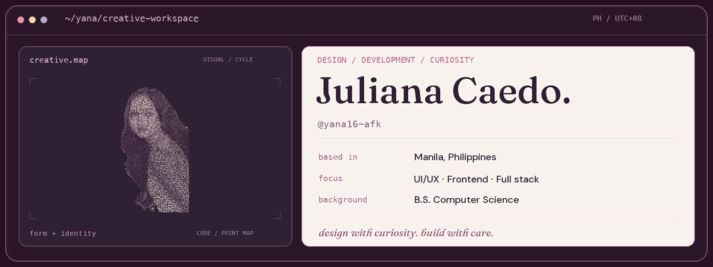
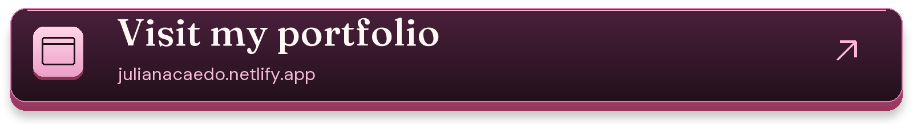
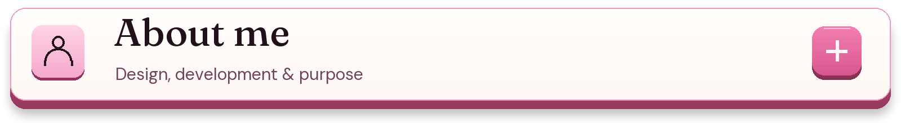
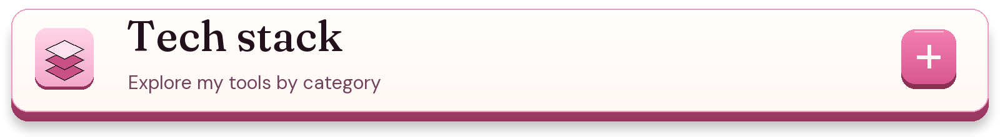
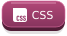
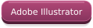
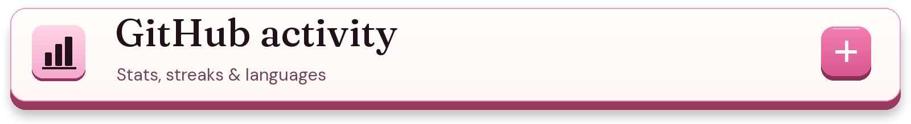
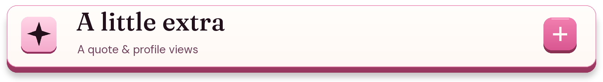
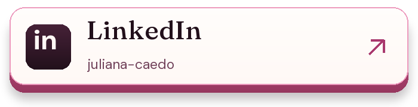
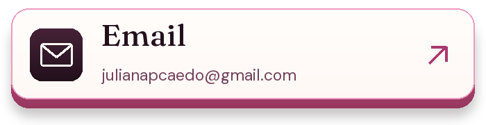

  <picture>
    <source media="(max-width: 600px) and (prefers-reduced-motion: reduce)" srcset="./assets/workspace-header-mobile.png" />
    <source media="(prefers-reduced-motion: reduce)" srcset="./assets/workspace-header.png" />
    <source media="(max-width: 600px)" srcset="./assets/workspace-header-mobile.gif" />
    
  </picture>

  <a href="https://julianacaedo.netlify.app/">
    <picture>
      <source media="(max-width: 600px)" srcset="./assets/portfolio-link-mobile.png" />
      
    </picture>
  </a>

<a href="https://julianacaedo.netlify.app/">julianacaedo.netlify.app</a>

Click a panel to explore. Open a little, or open it all.

  <picture>
    <source media="(max-width: 600px)" srcset="./assets/panels/about-mobile.png" />
    
  </picture>

Hi, I’m <strong>Juliana</strong>, a <strong>Computer Science graduate from the Polytechnic University of the Philippines, Manila</strong>, focused on <strong>web and Android development</strong>. I bring UI/UX and implementation together—from user flows and frontend interfaces to backend logic and databases.

<ul>
  <li>🏛️ <strong>DOST Project LODI:</strong> previously a <strong>Designer/Analyst Intern</strong>, working on PIMS requirements, functional specifications, workflows and user-centered interfaces.</li>
  <li>🎨 <strong>UI/UX with implementation in mind:</strong> Figma wireframes, prototypes and user flows designed for clear, consistent interfaces.</li>
  <li>💻 <strong>Web development:</strong> PHP and MySQL work on <strong>Planado PH</strong>, and responsive interface design and frontend collaboration on <strong>TugmaTik</strong>.</li>
  <li>📱 <strong>Android development:</strong> <strong>E-Collect</strong>, using Java and Google Maps API, with mobile UI and user flows designed in Figma.</li>
  <li>🤝 <strong>Design community:</strong> contributed UI components and visual materials through <strong>AWS Cloud Club–PUP</strong>, collaborating with design, marketing and development teams.</li>
</ul>

💬 Let’s talk UI/UX, web and Android development, or creative collaboration.

  <picture>
    <source media="(max-width: 600px)" srcset="./assets/panels/stack-mobile.png" />
    
  </picture>

Tools across my projects, coursework and continued learning.

  
  
  
  
  
  
  
  
  
  
  
  
  
  
  

UI/UX practices: wireframing, prototyping and user flows.

<strong>Additional tools and technologies</strong>

<h3>Data and computer vision</h3>

  
  
  
  
  
  

<h3>Design and documents</h3>

  
  
  
  
  

<h3>Deployment and networking</h3>

  
  
  

  <picture>
    <source media="(max-width: 600px)" srcset="./assets/panels/activity-mobile.png" />
    
  </picture>

These cards reflect public data available to each service. Hidden activity may be missing; language percentages describe repository contents.

<!-- Trophy widget is disabled: the supplied provider returned HTTP 402 during verification.
     Restore an image only after checking that its endpoint returns a valid SVG.
     https://github-profile-trophy.vercel.app/?username=yana16-afk&theme=flat&no-frame=true&no-bg=true&column=4
-->

  <picture>
    <source media="(max-width: 600px)" srcset="./assets/panels/extras-mobile.png" />
    
  </picture>

<h3>Developer quote</h3>

  <a href="https://www.linkedin.com/in/juliana-caedo"><picture>
    <source media="(max-width: 600px)" srcset="./assets/connect-linkedin-mobile.png" />
    
  </picture></a>
  <a href="mailto:julianapcaedo@gmail.com"><picture>
    <source media="(max-width: 600px)" srcset="./assets/connect-email-mobile.png" />
    
  </picture></a>

<em>a little code, a lot of curiosity. ♡</em>

